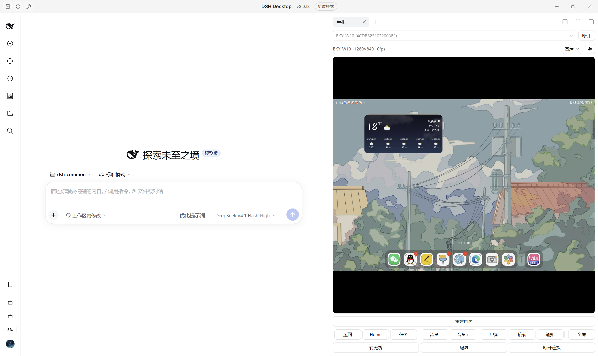

# dsh-phone-mirror

English | [中文](README.md)

[](https://github.com/liyuhan7/dsh-phone-mirror/actions/workflows/ci.yml)
[](./LICENSE)

Mirror and control your phone directly inside the DSH right sidebar: reply to messages, check notifications, or watch videos without picking up the device. Video and audio stream in real time, driven by your desktop mouse and keyboard.

Two independent device paths:

- **Android**: scrcpy 5.0.1 (H.264 + Opus) with browser WebCodecs; falls back automatically to `adb screencap` polling when scrcpy cannot start.
- **iPhone / iPad (iOS 27+)**: CoreDevice `DisplayService` (HEVC `hvcC` + AAC-ELD 48 kHz stereo) with tunnel HID input — no jailbreak and no app installed on the device.



## Features

- **Persistent sidebar tab & shared session**: Add the "手机" tab from the right sidebar's "+". Collapsing the sidebar or switching tabs pauses media streaming while keeping the device session alive, resuming from a live keyframe when you return. Switching DSH chats keeps the tab in view on the same connection; closing the last phone tab disconnects and releases the device session.
- **Low-latency media pipeline**: Stream parsing and decoding run in a Worker so DSH chat rendering does not stall the mirror. On iOS, video, audio, touch, and scroll connect directly to the local sidecar (bypassing the DSH host event loop), decoded frames render through the browser media pipeline (`VideoTrackGenerator` → `<video>`), inbound media UDP bypasses the userspace IP stack, and local traffic ignores system proxy variables.
- **Mouse and keyboard control**: Click, long-press, drag, and wheel scroll map to native device gestures. Keystrokes are forwarded directly — on iOS, switch the desktop IME to English and type pinyin for the phone's IME to compose; on Android, ASCII keys inject directly and composed CJK text pastes via clipboard.
- **Audio forwarding**: Opus 48 kHz stereo on Android and AAC-ELD 48 kHz stereo on iOS, played through an AudioWorklet ring buffer with smooth crossfading on catch-up. Wireless sessions raise the audio buffer floor and retention window to absorb Wi-Fi jitter. Falls back to silent mode when unsupported.
- **Cable to Wi-Fi**: On Android, "转无线" switches USB debugging to TCP and reconnects (Android 11+ also supports wireless debugging pairing). On iOS, "转无线" completes RemotePairing over USB and learns the phone's IP; "手填地址" also dials an IPv4 address directly, including first-time pairing.

## Requirements

| Item | Requirement |
| --- | --- |
| DSH | `>= 0.2.0-rc.1 < 0.3.0` |
| Node.js | 20+ (only for initial tool fetch or local builds) |
| Host OS | Windows is the primary tested platform; macOS / Linux fetch matching `platform-tools`, and iOS requires a working `usbmuxd` |
| Android device | USB debugging enabled and authorized; Android 11+ for audio forwarding |
| iPhone / iPad | **iOS 27+** with Developer Mode enabled; Windows needs Apple Devices or iTunes. The iOS runtime ships with the plugin (no manual Python install needed) |

Per-brand Android USB debugging instructions: [docs/debugging.md](docs/debugging.md) (Chinese).

## Installation

```bash
# Install prebuilt package from npm (recommended)
dsh plugin --profile <profile> add dsh-phone-mirror

# Or install directly from GitHub
dsh plugin --profile <profile> add "github:liyuhan7/dsh-phone-mirror"
```

Dependencies are fetched on demand on first use:

- **Android**: Downloads `platform-tools` (~8 MB) into the plugin directory (or run `npm run fetch:tools`, or set `adbPath` to reuse an existing adb).
- **iOS**: The Windows x64 runtime (embedded Python + `pymobiledevice3` + `PyAV`, ~100 MB zipped) installs via an npm optional dependency. If missing or skipped, the first connection downloads it from GitHub Releases into `~/.dsh/phone-mirror-ios-runtime/`; only if both fail does it fall back to local Python 3.11+.

## Quick Start

### Android

1. Enable "Developer options → USB debugging", connect USB, and accept the prompt with "Always allow".
2. Add the "手机" tab in DSH's right sidebar, select "安卓", pick the device, and press "连接".
3. Press "转无线" to switch to `adb tcpip 5555` and reconnect over Wi-Fi, then unplug. On Android 11+, "配对" also supports wireless debugging pairing with a 6-digit code.

### iPhone / iPad

1. Enable "Settings → Privacy & Security → Developer Mode" and reboot when prompted.
2. Connect USB, unlock the phone, tap "Trust", and enter the passcode.
3. In the "手机" tab, switch platform to "iOS", select `iPhone`, and press "连接" (the first run prepares the runtime and mounts the Developer Disk Image — keep the phone unlocked).
4. **Wireless**:
   - **Switch to Wi-Fi**: Keep USB connected and press "转无线". Wait until the wireless address is verified, unplug, then select `iPhone (Wi-Fi)` and press "连接".
   - **Manual IP**: Press "手填地址" and enter the phone's IPv4 address directly; an unpaired device prompts "Trust" on screen and completes pairing automatically.
   - **Personal Hotspot**: Connect the PC to the iPhone's hotspot for near-USB wireless smoothness.

Full iOS guide, keyboard usage, and troubleshooting: [docs/ios.md](docs/ios.md) (Chinese).

**Expected result**: Live video appears in the sidebar with the header showing `device · resolution · live fps` (e.g., `iPhone · 1290×2796 · 60fps`).

## Using the Panel

- **Video & touch**: Click, long-press, drag, and wheel scroll drive the device. Press "重建画面" if video turns black or stalls to request a fresh keyframe. Use "全屏 / 退出全屏" to toggle fullscreen.
- **Keyboard**:
  - **Android**: Click the screen to capture keys (`Esc` releases focus). ASCII injects per key; composed IME text pastes via clipboard.
  - **iOS**: Click the screen to capture keys. Set the desktop IME to English and type pinyin so the phone's IME composes with its on-screen candidate bar (pick with digits, space, or enter). `Esc` forwards to the phone, `Ctrl+Space` switches language, and rotating the phone returns the on-screen keyboard.
- **Toolbar**:
  - Android: Back, Home, Recents, Vol-, Vol+, Power, Rotate, Notifications, Fullscreen
  - iOS: Home, Recents, Vol-, Vol+, Power, Rotate, Notifications, Control Center, Fullscreen
- **Audio & quality**: The speaker button toggles playback (disabled when audio or decoder is unavailable). Quality presets (720 / 1080 / 1600) apply to Android only; iOS always streams at native resolution.
- **Wireless controls**: Dropped iOS wireless sessions auto-reconnect within 90 seconds. "断开连接" stops wireless mirroring and removes the entry from the list while keeping pairing records.

## Configuration

Override defaults in your profile's `cordis.patch.yml`:

```yaml
- id: dsh-phone-mirror
  config:
    maxSize: 1600
    maxFps: 60
    videoBitRate: 8000000
```

| Field | Default | Description |
| --- | --- | --- |
| `mode` | `auto` | Android mode: `auto` tries scrcpy (retrying without audio), then falls back to screencap |
| `maxSize` | `1280` | Max long-edge pixels, overridden by panel preset (Android only) |
| `maxFps` | `60` | Encoder FPS cap (Android only) |
| `videoBitRate` | `8000000` | Encoder bitrate in bps (Android only) |
| `screencapIntervalMs` | `260` | Polling interval (ms) for Android screencap fallback |
| `audio` | `true` | Forward device audio; falls back to silent on unsupported devices |
| `adbPath` | empty | Custom adb binary path; uses bundled copy when empty |
| `serverJar` | empty | Custom `scrcpy-server.jar` path |
| `iosWirelessHost` | empty | Manual iPhone wireless IPv4 (e.g., `10.4.53.159`), overriding the learned address |

## FAQ

**`adb devices` is empty while the phone is plugged in**
Windows may have bound the USB interface to a vendor driver (e.g., Huawei HDB). Switch it to "Android ADB Interface" in Device Manager or install the Google USB Driver.

**`dsh plugin` refuses to modify the desktop profile**
The desktop profile is managed by Electron. Edit the profile's `package.json` directly: add `"dsh-phone-mirror": "link:D:/path/to/dsh-phone-mirror"` to `dependencies`, add the plugin name to `dsh.profile.bundles`, and run `pnpm install`.

**No sound**
Check whether the speaker button is disabled: on Android, inspect `session.audio` and `session.audioCodec` at `/dsh-phone-mirror/api/status`; on iOS, a disabled button means the host lacks an AAC-ELD decoder. If enabled with no audio, check host/device volume and whether the app blocks audio capture.

**iPhone wireless fails to connect, or stutters on campus/enterprise Wi-Fi**
Campus and corporate APs often block mDNS multicast or enforce Proxy ARP / controller hair-pinning, breaking discovery or adding wireless jitter. Reconnect over USB once to refresh the learned address or use "手填地址". For smooth wireless mirroring close to USB, prefer a **5 GHz personal/mobile hotspot** or a **USB cable**. See [docs/ios.md](docs/ios.md).

**Black screen or single-digit FPS**
DRM-protected video apps on Android render black over secure `MediaCodec` surfaces. When the screen is static, the encoder emits no new frames, so a single-digit FPS readout is normal.

## Documentation & License

- [docs/ios.md](docs/ios.md): iPhone / iPad setup, direct pipeline notes, wireless tips, and troubleshooting (Chinese)
- [docs/debugging.md](docs/debugging.md): Per-brand Android USB & wireless debugging (Chinese)
- [THIRD-PARTY.md](THIRD-PARTY.md): Third-party components and licenses (Chinese)

MIT License — see [LICENSE](./LICENSE). Third-party licenses are listed in [THIRD-PARTY.md](./THIRD-PARTY.md).
