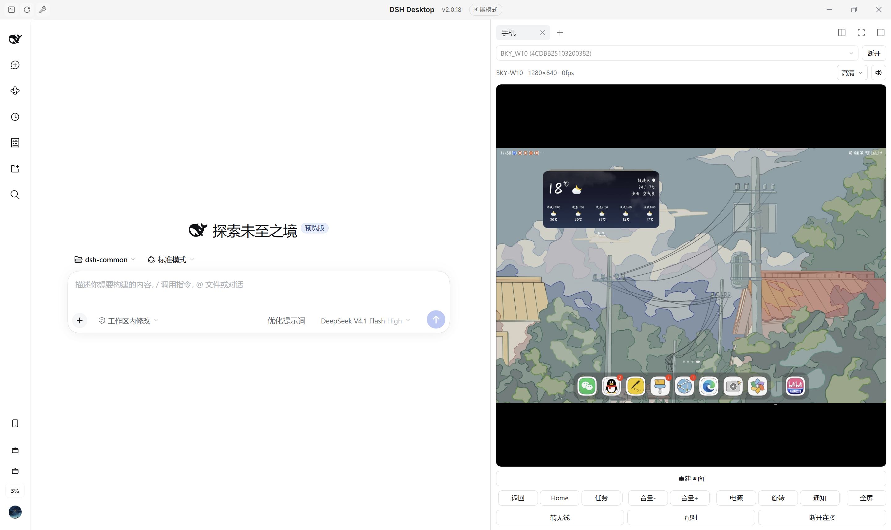

# dsh-phone-mirror

English | [中文](README.md)

While your agent works, your phone lives in the sidebar: watch a video, reply to messages, check notifications without leaving the desktop — no more picking the phone up and putting it down.

Under the hood it is scrcpy 5.0.1 plus browser-side WebCodecs: the Android screen is mirrored into the DSH right sidebar and driven by your mouse and keyboard.



[](https://github.com/liyuhan7/dsh-phone-mirror/actions/workflows/ci.yml)
[](./LICENSE)

## Features

- **A tab in the right sidebar**: add the "手机" tab from the sidebar's "+" and the device screen appears, scaled to fit; switching tabs keeps the session, closing the tab disconnects and releases the device-side process.
- **Mouse and keyboard control**: clicks, drags and wheel scrolling are sent over the scrcpy control protocol; ASCII characters are injected as key events, non-ASCII text goes through the device clipboard, and the pinyin of a composition is shown under the panel.
- **Audio forwarding**: Opus 48 kHz stereo through an AudioWorklet ring buffer, 80 ms startup buffer that grows to 240 ms on underrun; devices without capturable audio fall back to a silent session.
- **Decoding on a worker thread**: the stream, H.264 decoding, drawing and audio decoding all run in a Worker, so DSH spending the main thread on chat rendering or file writes does not stall the panel; without a Worker it falls back to the main thread.
- **Automatic fallback**: when scrcpy cannot start, the plugin polls `adb screencap` instead (260 ms per frame by default), which is slow but works on almost any device adb can reach.
- **From cable to Wi-Fi**: the panel's "转无线" switches USB debugging to TCP and connects automatically, so you can unplug and keep mirroring; stock Android 11+ can also pair through Wireless debugging.

Panel labels are Chinese only; the plugin does not ship translations yet.

## Quick start

**Requirements**

- Windows only — the bundled adb path is fixed at `tools/platform-tools/adb.exe`
- DSH `>= 0.2.0-rc.1 < 0.3.0`
- Node.js 20+ (only for the first tool download and for building)
- Android device with Developer options → USB debugging enabled and authorized
- Audio forwarding needs Android 11+

Per-brand USB debugging instructions: [docs/debugging.md](docs/debugging.md) (Chinese).

**Install**

```bash
# npm package, prebuilt install
dsh plugin --profile <profile> add dsh-phone-mirror
# or straight from the repository
dsh plugin --profile <profile> add "github:liyuhan7/dsh-phone-mirror"
```

**adb**

The first run downloads `platform-tools` (about 8 MB) into the plugin directory; run `npm run fetch:tools` inside `<profile dir>/node_modules/dsh-phone-mirror` to do it by hand:

```bash
npm run fetch:tools
```

If adb is already installed, point `adbPath` at it instead.

**Run**

1. Restart DSH and add the "手机" tab from the right sidebar's "+"
2. Pick your device at the top and click "连接"
3. Accept "Allow USB debugging" on the device, with "Always allow" checked
4. To drop the cable, press "转无线" at the bottom of the panel and unplug once it reports the wireless address

**Expected result**: the panel shows the device screen and the caption reads `BKY-W10 · 1048×1600 · 30fps` (device · resolution · live fps).

## Usage

```text
click / drag / wheel    operate the device directly
keyboard                click the screen to capture it; Esc releases focus
fullscreen              the "全屏" toolbar button
quality                 smooth 720 / standard 1080 / high 1600
wireless                "转无线" switches USB to TCP and connects automatically
pairing                 "配对" takes the pairing address and 6-digit code
"断开连接"              drops the wireless channel only; USB is untouched
```

If the picture is corrupted or black, press "重建画面": the decoder is dropped and the stream re-attached so the device sends a fresh keyframe.

## Configuration

Override in the profile's `cordis.patch.yml`:

```yaml
- id: dsh-phone-mirror
  config:
    maxSize: 1600
    maxFps: 60
    videoBitRate: 8000000
```

| Field | Default | Description |
| --- | --- | --- |
| `mode` | `auto` | `auto` tries scrcpy first (retrying without audio), then falls back to screencap |
| `maxSize` | `1280` | Long-edge pixel cap, overridden by the panel's quality preset |
| `maxFps` | `60` | Encoder frame rate cap |
| `videoBitRate` | `8000000` | Encoder bit rate in bps |
| `screencapIntervalMs` | `260` | Frame interval in the screencap fallback |
| `audio` | `true` | Forward device audio; unsupported devices start silent next time |
| `adbPath` | empty | Custom adb path, the bundled one when empty |
| `serverJar` | empty | Custom `scrcpy-server.jar` path |

## FAQ

**`adb devices` is empty although the phone says it is connected**

Windows bound the USB interface to a vendor driver (Huawei HDB, for instance). In Device Manager, update that interface to "Android ADB Interface", or install Google USB Driver and point it there.

**`dsh plugin` refuses to touch the desktop profile**

The desktop profile is owned by the Electron app. Edit that profile's `package.json` directly: add `"dsh-phone-mirror": "link:D:/path/to/dsh-phone-mirror"` to `dependencies`, add the plugin name to `dsh.profile.bundles`, then run `pnpm install`.

**No sound**

Check the speaker button first: grey means this session never got audio — see `session.audio` and `session.audioCodec` at `/dsh-phone-mirror/api/status`. If the button is enabled but you hear nothing, check the computer volume, the device volume, and whether the app that is playing forbids capture.

**Black picture, or a single-digit frame rate**

DRM content (paid video apps) goes through `MediaCodec`'s secure path and can only render black; when the device screen is static, scrcpy produces no frames, so a single-digit rate is expected.

## License

MIT, see [LICENSE](./LICENSE); third-party components in [THIRD-PARTY.md](./THIRD-PARTY.md).
