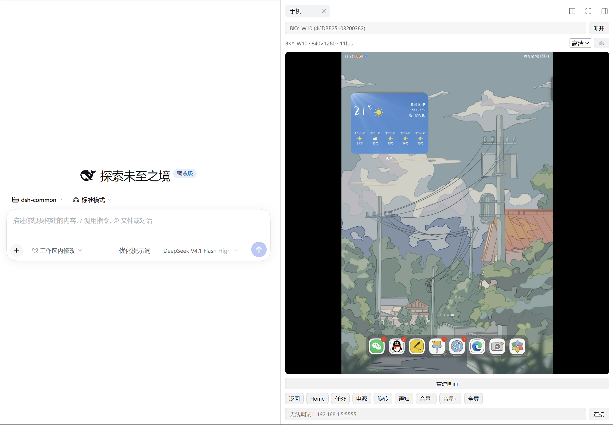

# dsh-phone-mirror

把安卓手机或平板投到 [DeepSeek Harness](https://github.com/deepseek-ai)（下称 DSH）的右侧栏，并用鼠标键盘直接反控。

插上数据线，右侧栏点「手机」页签，设备画面就出现在面板里；点按、拖拽、滚轮、键盘输入都作用在设备上。

画面链路复用 scrcpy 的内核：设备端用系统编码器编 H.264，桌面端用浏览器原生 WebCodecs 解码到 canvas。不需要 root，也不用在手机上装 App。60fps 下延迟在几十毫秒量级。



[](https://github.com/liyuhan7/dsh-phone-mirror/actions/workflows/ci.yml)
[](./LICENSE)
[](#环境要求)

## 功能

- 侧栏「手机」页签，画面即点即控，可全屏
- 鼠标点按 / 拖拽 / 滚轮，键盘输入；返回、Home、任务、电源、旋转、通知、音量
- 声音一起转发（Opus 48kHz 立体声），面板上一键静音；设备拿不到音频时自动退回无声会话
- 画质档位：流畅（长边 720）/ 标准（1080）/ 高清（1600）
- 设备选择，无线调试地址直连
- scrcpy 起不来时自动降级到 `adb screencap` 截图模式，帧率低但几乎任何设备都能出画面
- 会话跟随页签：切走保留，关闭页签断开并释放设备端进程，刷新页面自动重连

## 环境要求

- **Windows**（目前只支持 Windows：内置 adb 的路径写死为 `tools/platform-tools/adb.exe`）
- DSH `>= 0.2.0-rc.1 < 0.3.0`
- Node.js 20+，只用于首次下载工具和构建，运行时不依赖
- 设备：安卓 5.0+，或 HarmonyOS 4.x（**HarmonyOS NEXT / 5.x 没有 adb，不可用**）
- 转发声音需要 Android 11+（`AudioPlaybackCapture`）；更低版本只投画面
- 手机/平板已开启「开发者选项 → USB 调试」，并允许过这台电脑的调试授权

实际验证环境：Windows 11 + HarmonyOS 4.2 平板（华为 MatePad Air，`BKY-W10`）。

## 安装

```bash
# 从 GitHub 安装
dsh plugin --profile <你的 profile> add "github:liyuhan7/dsh-phone-mirror"

# 或从本地仓库链接（改代码后刷新页面即可生效）
dsh plugin --profile <你的 profile> add "link:D:/path/to/dsh-phone-mirror"
```

首次使用还要下载 adb 和 scrcpy-server（约 9MB）：

```bash
cd <插件目录>
npm run fetch:tools
```

`tools/platform-tools/` 是下载产物，不进仓库。系统里已有 adb 时可以在配置里指定 `adbPath` 跳过下载。

DSH Desktop 的 `desktop` profile 由应用独占托管，`dsh plugin` 会拒绝写入，需要按「排障」里的方式直接改 profile 的 `package.json`。

装完重启 DSH，右侧栏点「+」添加「手机」页签。

## 使用

1. 插上数据线，手机弹出「允许 USB 调试吗？」时勾选「始终允许」
2. 面板顶部下拉选中设备，点「连接」
3. 鼠标直接操作；标题行显示当前分辨率和实时帧率

**无线调试**：手机上打开「开发人员选项 → 无线调试」并完成配对，在面板底部输入框填 `192.168.x.x:端口` 点「连接」。

**画质**：档位按长边像素切换，卡顿时先降档。画面发花或全黑时点「重建画面」，会丢弃解码器并重新拉流，由设备重发关键帧。

**键盘**：点击画面即接管键盘。ASCII 可打印字符按按键注入；中文等非 ASCII 文本改走设备剪贴板加粘贴——安卓的键盘映射表里没有汉字键位，逐字符注入会被静默丢弃。组字过程中面板底部显示拼音预览。回车、退格、方向键、Home/End、PageUp/Down 走键码，Ctrl/Alt 组合会带上修饰键状态。按 `Esc` 交还键盘焦点，回到对话里继续打字。

**会话**：打开页签接入已有会话，切换页签保留会话，关闭页签结束会话并释放设备端进程。

## 配置

在 profile 的 `cordis.patch.yml` 里覆盖：

```yaml
- id: dsh-phone-mirror
  config:
    maxSize: 1600         # 画面长边像素；越小越流畅
    maxFps: 60
    videoBitRate: 8000000 # 8 Mbps
    mode: auto            # auto | scrcpy | screencap
```

| 字段 | 默认 | 说明 |
| --- | --- | --- |
| `mode` | `auto` | `auto` 先试 scrcpy（失败重试一次），仍失败才降级截图 |
| `maxSize` | `1280` | 长边像素上限，可被面板的画质档位覆盖 |
| `maxFps` | `60` | 编码帧率上限 |
| `videoBitRate` | `8000000` | 编码码率（bps） |
| `screencapIntervalMs` | `260` | 降级模式的截图间隔 |
| `adbPath` | 空 | 自定义 adb 路径，留空用插件自带的 |
| `serverJar` | 空 | 自定义 `scrcpy-server.jar` 路径 |
| `audio` | `true` | 转发设备声音；设备不支持时自动跳过带音频的尝试，并在下次连接时直接无声开场 |

## 已知限制

- **音频**：需要 Android 11+。每个 App 可以声明自己不可被捕获，这类 App 只有画面没有声音；设备没有任何播放时收到的是静音帧，属于正常现象。
- **DRM 内容**：付费视频类 App 通常输出黑屏，这是 `MediaCodec` 的安全视频通路，不是插件问题。
- **HarmonyOS NEXT / 5.x** 没有 adb，无法使用。
- **无线调试**：部分华为/荣耀机型没有「无线调试」入口，只能用 USB。
- **帧率随画面变化**：scrcpy 只在画面变化时出帧，停在静态界面时标题行只有个位数帧率，滑动或播放视频时才接近 60。
- **只监听本机**：宿主 HTTP 接口只接受 `127.0.0.1` 同源请求，不做公网暴露。

## 排障

**电脑完全不认设备**（`adb devices` 为空，但手机显示「USB 调试已连接」）
多半是 Windows 把这个接口绑到了厂商驱动（例如华为 HDB 的接口 GUID 与 adb 不同）。在设备管理器里把该 WinUSB 接口手动更新为「Android ADB Interface」，或装 Google USB Driver 后指定安装。

**会话降级成截图模式**
请求 `/dsh-phone-mirror/api/status`，`session.mode` 是 `screencap`、`session.lastError` 里带原因。常见原因是 `/data/local/tmp` 下的 jar 被清理（插件每次启动都会重推，一般能自愈），或者上一个会话的编码器还没释放（`auto` 模式会自动重试一次）。

**画面卡**
先降画质档位，再看标题行帧率是否明显低于 60。同时确认 DSH 没有别的标签页在跑大流量。

**画面卡住不动**
链路断了面板会自动重连，解码器卡死会自己重建并向设备重新要关键帧，连续追不上帧时还会自动降一档画质。都不管用时点「重建画面」。静止画面下帧率显示个位数是正常的，设备不重绘就不出帧。

**没有声音**
先看面板上的喇叭按钮是不是灰的：灰色表示这个会话压根没拿到音频，去 `/dsh-phone-mirror/api/status` 看 `session.audio` 与 `session.audioCodec`。按钮可用却听不到，检查电脑音量、平板是否静音，以及正在播的那个 App 是否禁止被捕获。

**`dsh plugin` 拒绝操作 desktop profile**
desktop profile 由 Electron 应用独占托管，CLI 会拒绝写入。直接编辑该 profile 的 `package.json`，在 `dependencies` 里加 `"dsh-phone-mirror": "link:D:/path/to/dsh-phone-mirror"`，并把插件名加进 `dsh.profile.bundles`，然后在 profile 目录执行 `pnpm install`。

## 目录结构

```
lib/index.js         宿主插件：路由、会话生命周期、帧中继
lib/session.js       scrcpy 会话（H.264/控制 socket）与截图兜底会话
lib/protocol.js      scrcpy 控制协议序列化
lib/adb.js           adb 封装
lib/client.js        浏览器端面板源码
lib/client.bundle.js 由 npm run build 生成，勿手改
scripts/             构建与工具下载
tools/               scrcpy-server.jar（platform-tools 为下载产物）
docs/                README 用图
```

## 开发

```bash
npm run build        # 重新生成 client.bundle.js
npm run check        # 语法检查 + 校验 bundle 是否过期
```

宿主代码改动需要重启 DSH 才生效，客户端 bundle 改动刷新页面即可。

## 许可

插件代码 MIT。`tools/scrcpy-server.jar` 来自 [Genymobile/scrcpy](https://github.com/Genymobile/scrcpy)（Apache-2.0），`platform-tools` 由脚本从 Google 官方地址下载，仓库不分发。详见 [THIRD-PARTY.md](./THIRD-PARTY.md)。
