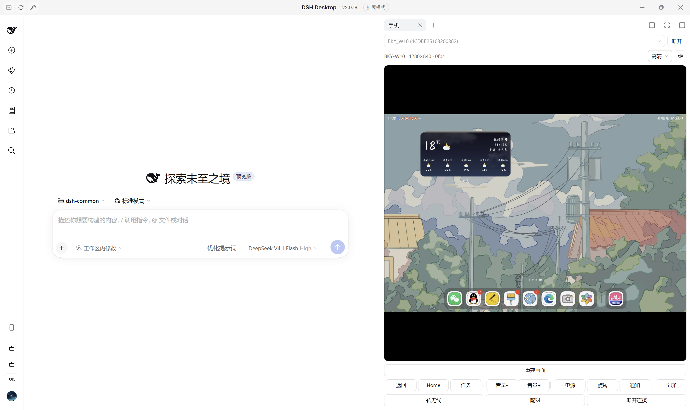

# dsh-phone-mirror

[English](README.en.md) | 中文

[](https://github.com/liyuhan7/dsh-phone-mirror/actions/workflows/ci.yml)
[](./LICENSE)

在 DSH 侧边栏里实时投屏并反控手机：回消息、看通知、刷视频都不用离开电脑。支持画面与声音同步转发，鼠标键盘直接操作设备。

两条独立设备链路：

- **安卓**：scrcpy 5.0.1（H.264 + Opus）+ 浏览器 WebCodecs；scrcpy 启动失败时自动降级为 `adb screencap` 轮询截图。
- **iPhone / iPad（iOS 27+）**：CoreDevice `DisplayService`（HEVC `hvcC` + AAC-ELD 48 kHz 立体声）+ 隧道 HID 反控，无需越狱，无需在手机端安装 App。



## 核心能力

- **侧边栏常驻与会话共享**：在右侧栏「+」添加「手机」页签即可投屏。收起侧栏或切到其他页签时暂停媒体传输但保留设备连接，切回后从实时关键帧恢复；切换 DSH 对话时跟随展示并共用同一连接；关闭最后一个手机页签才释放设备会话。
- **低延迟独立媒体链路**：解码在 Worker 线程运行，避免被 DSH 主线程对话渲染阻塞。iOS 侧视频、音频、触控与滚轮均直连本地 sidecar，画面优先走浏览器媒体管线（`VideoTrackGenerator` → `<video>`）渲染，sidecar 入站媒体 UDP 旁路用户态协议栈并自动隔离系统代理。
- **鼠标与键盘反控**：支持点按、长按、拖拽与滚轮。键盘逐键下发——iOS 切英文后直接敲拼音，由手机输入法组字并显示候选条；安卓英文数字逐键注入，中文经剪贴板粘贴上屏。
- **同步声音转发**：安卓为 Opus 48 kHz 立体声，iOS 为 AAC-ELD 48 kHz 立体声，经 AudioWorklet 环形缓冲与平滑交叉淡化播放；无线会话自动抬高缓冲水位以吸收网络抖动；不支持时自动降级为无声。
- **有线一键转无线**：安卓通过「转无线」切到 TCP 并自动连接（Android 11+ 也支持无线调试配对）；iOS 通过「转无线」在 USB 下完成无线配对与地址学习，也支持「手填地址」直连未配对或跨网段可见的设备。

## 环境要求

| 项目 | 要求 |
| --- | --- |
| DSH | `>= 0.2.0-rc.1 < 0.3.0` |
| Node.js | 20+（仅首次准备工具或本地构建时需要） |
| 电脑系统 | Windows 为主要验证平台；macOS / Linux 按平台下载 `platform-tools`，iOS 需本机 `usbmuxd` 可用 |
| 安卓设备 | 已开启并授权 USB 调试；音频转发需要 Android 11+ |
| iPhone / iPad | **iOS 27+**，已开启开发者模式；Windows 需安装 Apple Devices 或 iTunes，iOS 运行时随插件提供，无需手动装 Python |

各品牌安卓开启 USB 调试的入口与额外开关见 [docs/debugging.md](docs/debugging.md)。

## 安装

```bash
# 从 npm 安装（推荐，含预构建产物）
dsh plugin --profile <profile> add dsh-phone-mirror

# 或从 GitHub 仓库安装
dsh plugin --profile <profile> add "github:liyuhan7/dsh-phone-mirror"
```

首次运行按需自动准备依赖：

- **安卓**：下载 `platform-tools`（约 8 MB）到插件目录，也可手动执行 `npm run fetch:tools`，或在配置里设置 `adbPath` 复用系统已有 adb。
- **iOS**：Windows x64 运行时（嵌入式 Python + `pymobiledevice3` + `PyAV`，压缩包约 100 MB）随 npm 可选依赖安装；缺失或被跳过时首次连接自动从 Release 下载到 `~/.dsh/phone-mirror-ios-runtime/`，都不可用才回退到本机 Python 3.11+。

## 快速上手

### 连接安卓

1. 打开「开发者选项 → USB 调试」，插上数据线并在手机弹窗勾选「始终允许」。
2. 在 DSH 右侧栏点「+」添加「手机」页签，平台选「安卓」，选中设备点「连接」。
3. 需要无线时点底部「转无线」，插件读取 WLAN 地址、切到 `adb tcpip 5555` 并自动重连，之后可拔线。Android 11+ 也可用「配对」输入无线调试配对地址与 6 位配对码。

### 连接 iPhone / iPad

1. 打开「设置 → 隐私与安全性 → 开发者模式」，按提示重启确认。
2. 插上数据线解锁手机，弹窗点「信任」并输入锁屏密码。
3. 在「手机」页签将平台切到「iOS」，选中 `iPhone` 点「连接」（首次连接自动准备运行时并挂载开发者镜像，全程保持亮屏解锁）。
4. **无线连接**：
   - **转无线**：保持 USB 连接点「转无线」，等提示地址验证通过后再拔线，然后选中 `iPhone (Wi-Fi)` 点「连接」。
   - **手填地址**：点「手填地址」输入手机当前 IPv4 直连；未配对过的设备会在手机弹「信任」，确认后自动完成配对并保存记录。
   - **个人热点**：手机开热点让电脑连上即可直连，体验接近 USB。

完整 iOS 指南、键盘用法与故障排查见 [docs/ios.md](docs/ios.md)。

**连接成功标志**：面板显示实时画面，顶部状态显示 `设备名 · 分辨率 · 实时帧率`（例如 `iPhone · 1290×2796 · 60fps`）。

## 面板操作

- **画面与触控**：点按、长按、拖拽与滚轮直接操作手机；画面发黑、花屏或卡住时点「重建画面」请求新关键帧；「全屏 / 退出全屏」切换窗口铺满。
- **键盘输入**：
  - **安卓**：点画面接管键盘，`Esc` 释放焦点；英文数字逐键发送，中文经剪贴板粘贴。
  - **iOS**：点画面接管键盘，电脑输入法切英文后直接敲拼音，候选条在手机上显示，用数字 / 空格 / 回车选字；`Esc` 转发给手机，`Ctrl+空格` 切换输入法；转动手机朝向自动交还软键盘。
- **工具栏**：
  - 安卓：返回、Home、任务、音量-、音量+、电源、旋转、通知、全屏
  - iOS：Home、任务、音量-、音量+、电源、旋转、通知、控制、全屏
- **声音与画质**：喇叭按钮控制播放静音（置灰表示缺少音频流或解码器）；画质档位（流畅 720 / 标准 1080 / 高清 1600）仅对安卓生效，iOS 固定按原生分辨率出流。
- **无线管理**：iOS 无线掉线会在 90 秒内自动重连；底部「断开连接」会停止无线投屏并将无线条目移出列表，保留配对记录。

## 配置

在 profile 的 `cordis.patch.yml` 中按需覆盖：

```yaml
- id: dsh-phone-mirror
  config:
    maxSize: 1600
    maxFps: 60
    videoBitRate: 8000000
```

| 字段 | 默认值 | 说明 |
| --- | --- | --- |
| `mode` | `auto` | 安卓模式：`auto` 优先 scrcpy（音频失败自动无声重试），仍失败降级截图 |
| `maxSize` | `1280` | 长边像素上限，可被面板画质档位覆盖（仅安卓） |
| `maxFps` | `60` | 编码帧率上限（仅安卓） |
| `videoBitRate` | `8000000` | 编码码率 bps（仅安卓） |
| `screencapIntervalMs` | `260` | 安卓截图降级模式的刷新间隔（ms） |
| `audio` | `true` | 是否转发设备声音；设备不支持时后续自动无声开场 |
| `adbPath` | 空 | 自定义 adb 可执行文件路径，留空使用插件自带版本 |
| `serverJar` | 空 | 自定义 `scrcpy-server.jar` 路径 |
| `iosWirelessHost` | 空 | 手动指定 iPhone 无线 IPv4（如 `10.4.53.159`），优先于自动学习地址 |

## 常见问题

**`adb devices` 为空，但手机已插线**
Windows 可能把接口绑到了厂商驱动（如华为 HDB）。在设备管理器中改为「Android ADB Interface」，或安装 Google USB Driver 后重新指定。

**`dsh plugin` 提示无法修改 desktop profile**
desktop profile 由 Electron 独占管理。直接编辑该 profile 的 `package.json`，在 `dependencies` 添加 `"dsh-phone-mirror": "link:D:/path/to/dsh-phone-mirror"`，将插件名加入 `dsh.profile.bundles` 后运行 `pnpm install`。

**没有声音**
先看喇叭按钮是否置灰：安卓请查看 `/dsh-phone-mirror/api/status` 中的 `session.audio` 与 `session.audioCodec`；iOS 置灰说明本机缺少 AAC-ELD 解码器。按钮可用仍无声时，检查电脑与手机音量，以及当前 App 是否禁止音频捕获。

**iPhone 无线连不上，或校园网无线下画面切页/声音有抖动**
校园网与企业 Wi-Fi 常屏蔽组播或启用 Proxy ARP / 网关绕行，导致 mDNS 发现失效或无线抖动放大。连不上时可插 USB 刷新自动学习地址或使用「手填地址」；若无线流畅度明显不如 USB，建议改用 **5 GHz 手机个人热点 / 电脑移动热点** 或 **USB 数据线**。详情见 [docs/ios.md](docs/ios.md)。

**画面发黑或帧率只有个位数**
安卓 DRM 加密视频（部分付费视频 App）受系统安全通路限制仅输出黑屏；设备画面静止时编码器不发新帧，帧率显示个位数属正常现象。

## 文档与许可

- [docs/ios.md](docs/ios.md)：iPhone / iPad 连接、直连传输说明、无线建议与故障排查
- [docs/debugging.md](docs/debugging.md)：各品牌安卓开启 USB 调试与无线调试
- [THIRD-PARTY.md](THIRD-PARTY.md)：第三方组件与许可说明

插件主体遵循 MIT 许可，见 [LICENSE](./LICENSE)；第三方组件许可见 [THIRD-PARTY.md](./THIRD-PARTY.md)。
